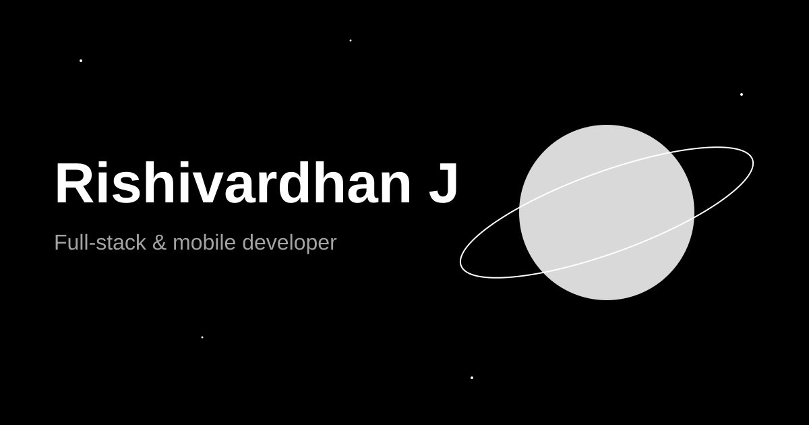
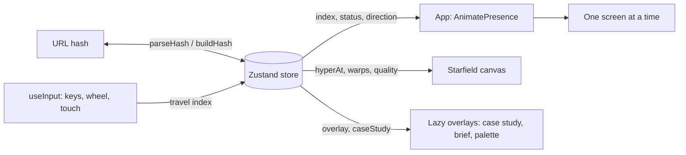

<div align="center">



# Galaxy

**A no-scroll, monochrome, space-themed portfolio. Five stops, one journey, zero scrollbars.**

[](https://github.com/Rishivardhan-J/Galaxy/actions/workflows/ci.yml)


[Resume](public/resume/Rishivardhan-J-Resume.pdf) · [Product requirements](<Galaxy Portfolio Product Requirements Document.md>) · [Architecture](#architecture)

</div>

---

## Why this exists

Most portfolios are a long scroll. Galaxy replaces it with five full-screen **stops** you travel between, with a warp transition, a live starfield and a WebGL planet. It should be memorable in ten seconds and credible in two minutes: striking motion up front, real engineering evidence (case studies, repos, live demos) one click deeper.

Everything is pure black and white, so the motion and typography carry the design.

## Highlights

- **No scrolling, no router.** Five fixed stops, with the URL hash as the route, so every stop and every case study is deep-linkable and the back button works.
- **Persistent starfield.** A canvas engine runs behind every screen, reacts to navigation (warp, hyperspace) and adapts its quality to the device's frame rate.
- **WebGL hero system.** A shaded planet with one orbiting moon per flagship project; clicking a moon opens its case study.
- **Command palette.** `Cmd/Ctrl + K` opens a fuzzy-search palette to jump to any stop, project or action.
- **Case studies as data.** Problem, approach, architecture and outcome pages, with generated architecture diagrams.
- **Accessible by design.** Focus moves to each new screen's heading, live-region announcements, focus-trapped overlays, an `inert` background, reduced-motion support and automated axe checks.
- **SEO without a server.** A React-rendered static shell is injected into `index.html` at build time and replaced once JS runs.
- **Performance budget enforced in the build.** The build fails if initial JS exceeds 200 KB gzip.

## The five stops

| # | Stop | Hash | What's there |
| --- | --- | --- | --- |
| 1 | **Launchpad** | `#launchpad` | Hero planet and moons, role, credibility stats |
| 2 | **Origin** | `#origin` | The story: education, internships, achievements, plus credentials grouped by issuer |
| 3 | **Star Systems** | `#star-systems` | Projects on a 3D orbit, with a dossier and full case studies |
| 4 | **Constellations** | `#constellations` | Skills drawn as an interactive star map |
| 5 | **Transmission** | `#transmission` | Contact channels (email, LinkedIn, GitHub, resume) |

Case studies live at `#star-systems/<slug>/<page>`, where `<page>` is `problem`, `approach`, `architecture` or `outcome`.

## Featured work

| Project | What it is |
| --- | --- |
| **Crime Analytics System Using AI** | Crime intelligence platform for cases, entities and relationships, with geospatial mapping, a relationship graph, classification-gated access and audit controls. *FastAPI · PostgreSQL · Neo4j · React · TypeScript* |
| **Transit** | Real-time logistics optimisation with ML-predicted delivery times and Hybrid Genetic Search routing, with route explainability. |
| **HarvestPro** | Turns AI crop predictions into advice small-scale Indian farmers can act on, in their language. |

Plus TrackIt, Bench and Forge as compact projects.

## Controls

| Input | Action |
| --- | --- |
| `1`–`5` | Jump to a stop |
| `←` `→` `↑` `↓` | Previous / next stop (or case-study page) |
| Mouse wheel, swipe | Travel between stops |
| `Cmd/Ctrl + K` or `/` | Command palette |
| `B` | Open the brief |
| `Esc` | Close overlay or case study |
| `E` `L` `G` `R` | On Transmission: email, LinkedIn, GitHub, resume |

## Tech stack

| Layer | Choice |
| --- | --- |
| UI | React 19, TypeScript |
| Build | Vite, Tailwind CSS 4 |
| State | Zustand (navigation state machine) |
| Motion | `motion` |
| Content validation | Zod |
| Graphics | Canvas 2D starfield, WebGL planet |
| Tests | Vitest + Testing Library, Playwright + axe-core |
| CI | GitHub Actions |

## Architecture



The store's `phase` runs `gate` → `warp` → `site`. A hash in the URL or a prior visit in the same session skips the gate.

```
src/
├── app/          App shell, input handling, focus trap
├── components/   Nav, minimap, bottom bar, motion helpers, SplitText
├── content/      Portfolio data (profile, projects, skills, stack) and Zod schemas
├── features/     starfield, planet, orbit, palette, case-study, brief, gate, hud, sound
├── screens/      Launchpad, Origin, StarSystems, Constellations, Transmission
├── state/        Zustand store and hash routing
├── styles/       Design tokens and global CSS
└── seo.tsx       Static SEO shell rendered at build time
```

Design decisions worth knowing:

- **Overlays are lazy chunks.** Case study, brief and palette mount over `main`, which becomes `inert` while they're open, and they stay out of the entry bundle.
- **Content is data.** Edits to copy, projects and skills go in `src/content/`, validated by Zod and `content.test.ts`, not in the screens.
- **Reduced motion is a store flag.** It toggles an `.rm` class on `<html>`, and animations use shorter durations.

## Getting started

Requires **Node 22**.

```bash
git clone https://github.com/Rishivardhan-J/Galaxy.git
cd Galaxy
npm ci
npm run dev
```

| Script | What it does |
| --- | --- |
| `npm run dev` | Vite dev server |
| `npm run build` | Type-check, build, prerender the SEO shell, enforce the size budget |
| `npm run preview` | Serve the production build |
| `npm run lint` | ESLint |
| `npm test` | Vitest unit tests |
| `npm run e2e` | Playwright end-to-end and accessibility tests (builds first) |

## Editing content

| To change | Edit |
| --- | --- |
| Name, links, timeline, credentials, launch stats | `src/content/profile.ts` |
| Projects and case studies | `src/content/projects.ts` |
| Skills and links on the star map (1000×560 space) | `src/content/skills.ts` |
| Tech stack groups | `src/content/stack.ts` |
| Colors | `src/styles/tokens.css` (monochrome only) |

## Quality

- **Budget:** initial JS under 200 KB gzip, checked by `scripts/check-size.mjs` on every build.
- **Tests:** unit tests for the store, orbit math, fuzzy search and content; Playwright journeys covering deep links, the palette, keyboard orbit control, reduced motion and WebGL-disabled fallback.
- **Accessibility:** axe runs at 375, 768 and 1440 px widths.
- **CI:** every push runs tests, the production build and the full Playwright suite; failures upload traces and screenshots.

## Deployment

Galaxy builds to static files in `dist/` and routing is hash-based, so no server rewrites are needed. Any static host works: use `npm run build` as the build command and `dist` as the output directory.

## Author

**Rishivardhan J**, Computer Science student at Sri Eshwar College of Engineering.

[GitHub](https://github.com/Rishivardhan-J) · [LinkedIn](https://www.linkedin.com/in/rishivardhan-j-ba9469399/) · [Email](mailto:rishivardhan.j2024cse@sece.ac.in)

&copy; 2026 Rishivardhan J. All rights reserved.
